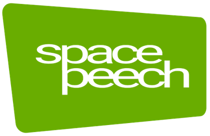
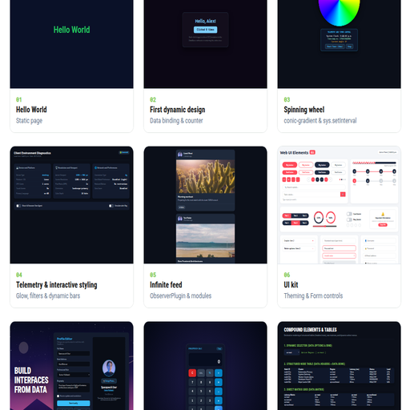

<a href="http://spacepeech.pages.dev">
<p align="center" >

<br>
</p>
</a>

<a href="http://spacepeech.pages.dev">
<h1 align="center">spacepeech</h1>
</a>

<p align="center">
A JSON document describing your entire UI — layout, data, styling, behavior — sent from wherever you want, rendered by a small engine that never rebuilds what it doesn't have to. No build step, no framework lock-in, no virtual DOM diffing the whole tree just to update one number.

<br>
</p>


[](./LICENSE)


## The idea

Most UI tools make you write the interface where it renders. Spacepeech doesn't: the UI is data. Define it as JSON — nodes, bindings, actions, styles — and hand it to the engine. The engine compiles it, keeps it reactive, and gets out of your way.

That data can come from anywhere: a static file, an API response, a WebSocket push mid-session. Change a value on the server and the UI updates on the client with zero redeploy. This is the core of what's usually called Server-Driven UI — a pattern built for interfaces that need to change without shipping a new client build every time.

## One engine, two superpowers

Spacepeech never touches more of the DOM than it needs to. A value changes, the engine finds the exact node by id and patches it — no tree diffing, no wasted work. That's what makes runtime updates fast even under heavy, frequent data changes.

The same mechanism is what lets it **hydrate** a page that's already rendered. Point it at static HTML your server already painted (great for SEO — crawlers see real content, not an empty `<div>`) and it adopts the existing DOM instead of tearing it down and repainting from scratch. Same engine, same idea, applied at two different moments: on load, and forever after.

## Built-in, not bolted on

- **Real-time sync** over WebSocket — server pushes patch the tree live, no polling.
- **Declarative actions** — click handlers, HTTP calls, timers, and conditional logic live in the JSON, not scattered across event listener files.
- **A closed expression grammar** for `{{...}}` bindings — comparisons, ternaries, logic, math. No `eval()`, no `Function()`, anywhere. The grammar simply has no rule for calling anything or reaching outside the data it's given.
- **A small plugin system** — forms, storage, observers, UI kit, and more, each opt-in and independent of the core.

## Built to be poked at

The core stays deliberately small on purpose — almost everything else is a plugin, and nothing stops you from writing your own just to see what happens. Register a custom element type, hook into the event bus, dispatch actions under your own namespace. There's no official list of "supported extension points" you have to stay inside of — if the engine exposes it, it's fair game. Half the fun of a new library is poking around and finding out what it lets you get away with, I need you to break things and let me know..

## The honest part

This is new. There's no ecosystem, no Stack Overflow answers waiting for you, no devtools extension — that's the real cost of building on something novel instead of something established, and it's worth saying plainly instead of pretending otherwise. What you get in exchange: an architecture simple enough that a developer coming from a completely different language stack can read the core in an afternoon, and a JSON contract clean enough that generating pages from a prompt or a prototype — via an AI skill running server-side — is a realistic workflow, not a stretch goal.

## Getting started

Copy the `spacepeech-lib` folder into your project — it's self-contained.

```html
<div id="canvas"></div>

<script type="module">
  import { spacepeechInit } from "./spacepeech-lib/src/spacepeech-loader.js";

  window.app = await spacepeechInit("canvas", {
    configUrl: "./spacepeech.config.json",
  });
</script>
```

Optionally—but it is recommended—you will want to have the "spacepeech.config.json" configuration file located in the same directory. It allows you to choose between local or remote operation, select either hydration mode or SPA mode, specify the backend server URL, define the directory for searching documents/modules, and—finally—determine whether to send telemetry data containing client information.

```json
{
  "mode": "website",
  "source": "api",
  "baseUrl": "http://[your_site.com]",
  "defaultPage": "controls",
  "handshakeEndpoint": "/api/telemetry"
}
```

Your first JSON "design" might look like the example below. It is quite easy to identify the function of each section; in this case, it simply displays a `div` containing an `H1` element with the text "Hello World," centered using Flexbox. In your preferred JSON editor, you can simply expand the relevant sections (until one day I finished the spacepeech editor :) ). A quick note: documents can be loaded by others (recursively) as components. In such cases, the parent document's global CSS rules override those of the child components—ensuring a consistent style across the overall design—while the child components apply their own inline styles to their individual nodes. Each component-document can be dynamically updated by its parent. At no point are IFrames used, even though the behavior might appear similar.

```json
{
  "version": "1.0",
  "meta": {
    "title": "Hello World — Spacepeech"
  },
  "root": {
    "id": "hello-root",
    "type": "div",
    "style": {
      "display": "flex",
      "align-items": "center",
      "justify-content": "center",
      "width": "100%",
      "height": "100%",
      "background": "#0a1128"
    },
    "children": [
      {
        "id": "hello-title",
        "type": "h1",
        "style": {
          "margin": "0",
          "color": "#22c55e",
          "font-family": "'Roboto', system-ui, sans-serif",
          "font-size": "4rem",
          "font-weight": "700"
        },
        "data": {
          "text": "Hello World"
        }
      }
    ]
  }
}
```

and it turns out looking this beautiful...


<br>

here for more [examples](https://spacepeech.pages.dev/examples)

<br>

<br>

## Documentation

- **Technical reference** — the full JSON [contract](contract.md)
- **User guide** — build your first page: [user guide](user-guide.md)

<a href="https://spacepeech.pages.dev/downloads"> 
<br>

<h1>Downloads here</h1>
</a>

## Status & license

Actively developed and working on an upcoming update. The core library is released under the **MIT License** — see [LICENSE](./LICENSE).

